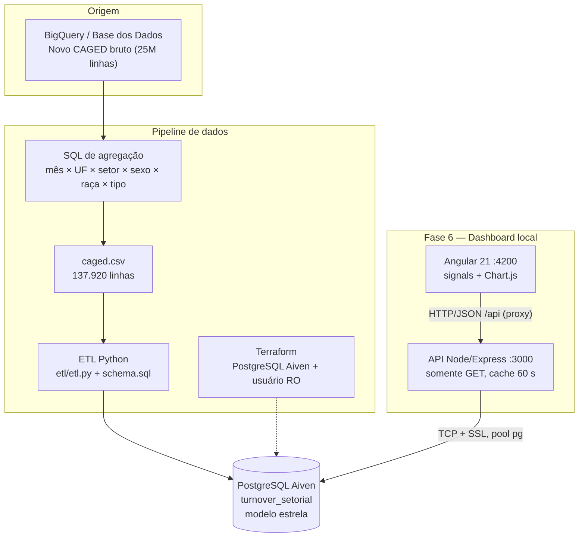
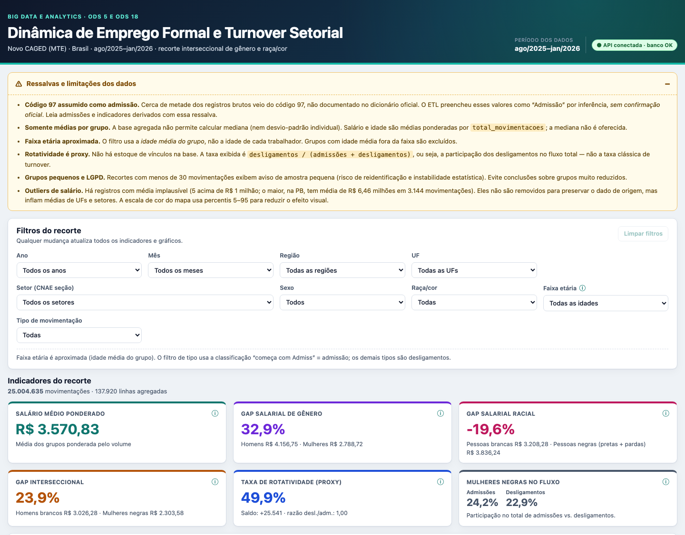
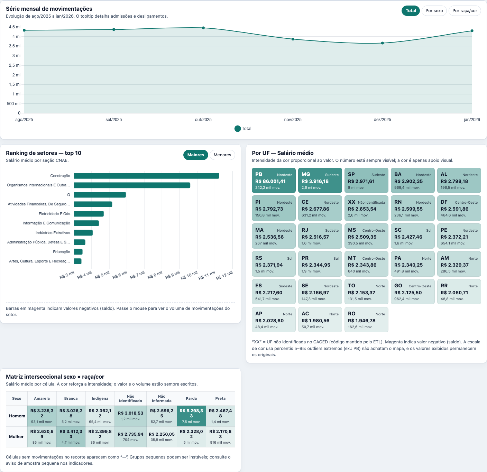
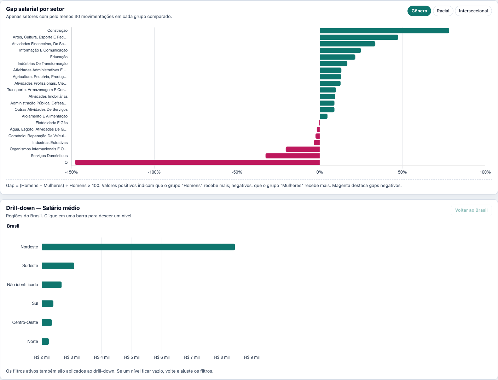
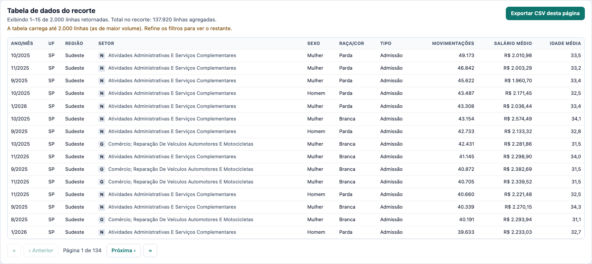

# Dinâmica de Emprego Formal e Turnover Setorial

Projeto prático da disciplina **Big Data e Analytics**. Tema: **Dinâmica de Emprego Formal e
Turnover Setorial** (Novo CAGED/MTE), com recorte interseccional de **gênero e raça/cor**
(ODS 5 e ODS 18).

## 1. Pergunta de negócio

> Como a rotatividade no emprego formal brasileiro varia por setor de atividade econômica
> (CNAE), e como isso se relaciona com o perfil de gênero e raça/cor dos trabalhadores admitidos
> e desligados?

**Alinhamento ODS:** ODS 5 (Igualdade de Gênero) e ODS 18 (Igualdade Étnico-Racial), via
cruzamento interseccional gênero × raça/cor.

## 2. Fonte e recorte

- **Fonte oficial:** Novo CAGED (Cadastro Geral de Empregados e Desempregados), Ministério do
  Trabalho e Emprego (MTE), divulgado via PDET.
- **Camada de acesso:** [Base dos Dados](https://basedosdados.org/dataset/562b56a3-0b01-4735-a049-eeac5681f056),
  que republica os microdados oficiais tratados no Google BigQuery.
- **Tabela principal:** `basedosdados.br_me_caged.microdados_movimentacao`, com apoio de
  `dicionario`, `cnae_2`, `uf` e `municipio`.
- **Janela:** agosto/2025 a janeiro/2026 (6 meses), Brasil inteiro.
- **Volume bruto:** 25.004.635 movimentações.
- **Volume agregado:** 137.920 linhas na tabela fato (agregação por mês × UF × seção CNAE ×
  sexo × raça/cor × tipo de movimentação).

A agregação no BigQuery foi necessária para caber no free tier de 1 GB da Aiven e preserva todos
os cruzamentos usados pelos KPIs. O custo é a perda de granularidade individual: **não é possível
calcular mediana** nem desvio-padrão por trabalhador.

## 3. Arquitetura



O Angular **não** acessa o PostgreSQL diretamente: a API é a única camada com credenciais, valida
todos os parâmetros e executa apenas `SELECT`.

## 4. Dashboard — execução em um comando

Pré-requisitos: Node.js 20+, npm e credenciais do PostgreSQL (Aiven ou local).

```bash
cd dashboard
cp api/.env.example api/.env     # preencha PGHOST, PGPORT, PGUSER, PGPASSWORD
npm install && npm run setup
npm run dev                       # API :3000 + Angular :4200
```

Abra **http://localhost:4200**. Detalhes de variáveis, testes, endpoints e segurança estão em
[`dashboard/README.md`](dashboard/README.md).

O que o dashboard entrega:

- **6 KPIs** interseccionais: salário médio ponderado, gaps de gênero/racial/interseccional,
  rotatividade proxy e participação de mulheres negras no fluxo;
- filtros combináveis de ano, mês, região, UF, setor, sexo, raça/cor, faixa etária e tipo;
- série mensal (total / por sexo / por raça/cor), ranking de setores, mapa por UF, matriz
  interseccional, gaps por setor, drill-down Região → UF → Setor e tabela com export CSV;
- faixa de ressalvas sempre acessível e estados de loading/erro por componente;
- formatação pt-BR (moeda BRL, números e percentuais).

## 5. Indicadores e regras de negócio

### Classificação de movimentação

| Classe | Regra |
|---|---|
| **Admissão** | tipo começa com “Admiss” (inclui “Admissão Por Reintegração”) |
| **Desligamento** | qualquer outro valor |

### Proxies (não há estoque de vínculos na base)

| Indicador | Fórmula |
|---|---|
| Admissões | Σ movimentações da classe Admissão |
| Desligamentos | Σ movimentações da classe Desligamento |
| Saldo | admissões − desligamentos |
| **Rotatividade (proxy)** | desligamentos ÷ (admissões + desligamentos) × 100 |
| Razão desligamento/admissão | desligamentos ÷ admissões |

### Gaps salariais

| Gap | Fórmula |
|---|---|
| Gênero | (salário homens − salário mulheres) ÷ salário homens × 100 |
| Racial | (salário brancas − salário negras) ÷ salário brancas × 100 |
| Interseccional | (salário homens brancos − salário mulheres negras) ÷ salário homens brancos × 100 |

Negra = preta + parda. Os gaps respeitam os filtros ativos, exceto a própria dimensão comparada;
quando o usuário filtra sexo/raça, o card mostra “n/d” com tooltip.

### Médias ponderadas

Salário e idade **nunca** usam `AVG` simples. A média é ponderada por `total_movimentacoes`:

```sql
SUM(f.salario_medio * f.total_movimentacoes) FILTER (WHERE f.salario_medio IS NOT NULL)
/ NULLIF(SUM(f.total_movimentacoes) FILTER (WHERE f.salario_medio IS NOT NULL), 0)
```

No recorte completo: **R$ 3.570,83** ponderado vs. R$ 2.902,48 no `AVG` simples (incorreto).
Mediana **não é oferecida**, porque a base só contém médias por grupo.

> **Ressalva obrigatória:** ~50% dos registros brutos vieram do código 97, não documentado no
> dicionário oficial; o ETL assumiu esses valores como “Admissão” por inferência, **sem
> confirmação oficial**. Admissões e indicadores derivados devem ser lidos com essa ressalva.

## 6. Screenshots

Prints gerados a partir da execução local (1440 px, filtros limpos):


*Figura 1 — Cabeçalho, ressalvas, filtros e os seis KPIs.*


*Figura 2 — Série mensal, ranking de setores, mapa por UF e matriz interseccional.*


*Figura 3 — Gaps por setor e drill-down Região → UF → Setor.*


*Figura 4 — Tabela paginada e exportação CSV.*

## 7. API — dicionário resumido

Base: `http://localhost:3000/api` (somente GET). Filtros comuns aceitam múltiplos valores
separados por vírgula; valores inválidos retornam 400.

| Endpoint | Descrição |
|---|---|
| `GET /health` | status da API e `SELECT 1` no banco |
| `GET /meta/filters` | anos, meses, UFs + região, setores, sexos, raças, tipos, faixas e totais |
| `GET /kpis` | os 6 KPIs + cobertura do recorte |
| `GET /series/mensal` | série mensal (`grupo=total\|sexo\|raca_cor`) |
| `GET /ranking/setores` | ranking por métrica (`limit`, `order`) |
| `GET /mapa/uf` | valor por UF + região |
| `GET /interseccao` | matriz sexo × raça/cor |
| `GET /gaps/setores` | gap por setor (`tipo_gap`) com amostra mínima de 30 |
| `GET /drilldown` | Região → UF → Setor (`nivel`, `pai`, `metrica`) |
| `GET /tabela` | recorte no grão da fato (até 5.000 linhas, paginação no cliente) |

Métricas válidas: `salario_medio`, `rotatividade`, `saldo`, `admissoes`, `desligamentos`,
`total_movimentacoes`, `idade_media`. Documentação completa: [`dashboard/README.md`](dashboard/README.md#6-dicionário-da-api).

## 8. Análise crítica (ODS 5 e ODS 18)

> Valores observados no recorte completo (ago/2025–jan/2026). Revalide na sua instância e
> substitua os trechos entre colchetes pela interpretação do grupo.

### 8.1 Panorama

| Indicador | Valor observado |
|---|---|
| Movimentações | 25.004.635 |
| Salário médio ponderado | R$ 3.570,83 |
| Rotatividade proxy | 49,9% |
| Saldo | +25.541 |
| Gap de gênero | 32,9% |
| Gap racial | −19,6% |
| Gap interseccional | 23,9% |
| Mulheres negras — admissões / desligamentos | 24,2% / 22,9% |

> **Outliers de salário:** há 5 registros com média acima de R$ 1 milhão (220 acima de R$ 50 mil);
> o maior é um grupo da PB com 3.144 movimentações e média de R$ 6.458.833,02. O dashboard não
> remove outliers para preservar o dado original. Por isso PB aparece com R$ 86.001,41 no mapa e a
> Construção lidera o ranking salarial. Sem os 5 registros acima de R$ 1 milhão, o salário
> ponderado geral cairia de R$ 3.570,83 para R$ 2.600,53.

### 8.2 Gênero (ODS 5)

O gap agregado é de **32,9%** (homens R$ 4.156,75; mulheres R$ 2.788,72). Os maiores gaps
setoriais aparecem em **Construção (78,1%)**, Artes/Cultura/Esporte (47,3%) e
Financeiras/Seguros (33,5%). A rotatividade agregada é próxima (homens 50,2%, mulheres 49,6%),
mas isso não significa ausência de desigualdade: [analisar segregação setorial/ocupacional,
diferenças dentro de cada setor, efeito do código 97 e composição da amostra].

### 8.3 Raça/cor (ODS 18)

O gap racial agregado é **−19,6%** (brancas R$ 3.208,28; negras R$ 3.836,24). O sinal negativo
**não** autoriza concluir que não há desigualdade racial: a média simples por raça tem outro
sinal (Parda R$ 2.851,18 vs. Branca R$ 3.367,12) e a média ponderada é puxada por grupos de
grande volume e salário médio alto (homens pardos: R$ 5.298,33). É um efeito de composição e de
outliers de médias agregadas. Os maiores gaps por setor estão na seção **Q (76,9%, sem descrição
no CSV)**, Organismos Internacionais (43,7%) e Eletricidade/Gás (40,0%). [Investigar a seção Q
antes de usar como conclusão; comentar composição setorial e qualidade do dado.]

### 8.4 Interseccionalidade (mulher negra × homem branco)

O gap interseccional é **23,9%** (homens brancos R$ 3.026,28; mulheres negras R$ 2.303,58). Os
maiores gaps setoriais estão em Financeiras (55,6%), Informação/Comunicação (49,1%) e
Artes/Cultura (48,1%). [Mostrar que a desvantagem da mulher negra não é a soma mecânica dos gaps
de gênero e racial; comparar setores e discutir o limite de uma base agregada.]

### 8.5 Rotatividade

Maiores taxas proxy: Administração Pública (59,8%), Educação (54,2%), Organismos Internacionais
(53,7%) e Agricultura (52,1%). Menores: Eletricidade/Gás (40,9%) e Artes/Cultura (46,8%).
Mulheres negras têm rotatividade de **48,4%** (abaixo da média de 49,9%), apesar do salário médio
menor. [Discutir estabilidade vs. mobilidade, tipos de desligamento e o fato de o proxy não usar
estoque.]

### 8.6 Limitações (parágrafo fixo)

Os resultados devem ser lidos com sete ressalvas: **(1)** o código 97 (~50% dos registros brutos)
foi assumido como admissão por inferência, sem confirmação oficial; **(2)** só existem médias por
grupo, então mediana e desvio-padrão individual não são calculáveis; **(3)** não há estoque de
vínculos, logo a rotatividade é um proxy (`desligamentos ÷ fluxo total`), não a taxa clássica;
**(4)** a faixa etária filtra a idade média do grupo, não a idade individual; **(5)** grupos com
menos de 30 movimentações são sinalizados por risco de reidentificação/instabilidade (LGPD);
**(6)** os gaps não controlam composição setorial, ocupação, jornada ou escolaridade, podendo
refletir composição e outliers, não discriminação pura; e **(7)** há registros com salário médio
implausível que não foram removidos — o maior deles distorce PB, Construção e os gaps racial e
interseccional.

## 9. Decisões técnicas e aprendizados

- **API intermediária:** o navegador não fala PostgreSQL; a API protege credenciais, valida
  entrada e expõe apenas leitura.
- **Médias ponderadas:** cada linha da fato é um grupo; `AVG` simples distorce o resultado. A
  ponderação por volume recupera a média do recorte (R$ 3.570,83 vs. R$ 2.902,48).
- **Whitelist de métricas:** a métrica vem da URL, mas o SQL é uma expressão fixa no servidor;
  isso evita injeção e impede oferecer “mediana” (impossível com os dados).
- **Validação contra `/meta/filters`:** rótulos de sexo/raça/cor vêm do banco, não são
  hardcoded; a API falha cedo se o dicionário do CAGED mudar.
- **Cache de 60 s e pool de conexões:** reduzem consultas repetidas e protegem o free tier.
- **Signals + `switchMap`:** filtros reativos com cancelamento de requisições antigas.
- **Segurança:** queries parametrizadas, somente `SELECT`, CORS restrito, `.env` fora do Git e
  opção de usuário `dashboard_ro` somente leitura via Terraform.

Aprendizados: [síntese do grupo sobre agregação, ponderação, qualidade do CAGED,
interseccionalidade e comunicação de incerteza].

## 10. Estrutura do repositório

```text
.
├── README.md
├── decisoes-projeto.md          # decisões das fases anteriores
├── bigquery/                    # SQL de agregação na origem
├── etl/                         # ETL Python, schema estrela e CSV agregado
├── terraform/                   # Aiven PostgreSQL + usuário somente leitura
├── dashboard/                   # Fase 6 (Angular + API + README detalhado)
├── docs/screenshots/            # prints do dashboard
└── spec.md                      # especificação da Fase 6
```

## 11. Como reproduzir o pipeline (fases anteriores)

1. Execute o SQL em `bigquery/query.sql` na Base dos Dados e exporte o CSV agregado.
2. Provisione a infraestrutura com `terraform/` (variáveis em `terraform.tfvars`, não
   versionado).
3. Crie o schema com `etl/schema.sql` e rode `etl/etl.py` com as variáveis `PG*` configuradas.
4. Suba o dashboard com `cd dashboard && npm run dev`.

## 12. Critérios de aceite da Fase 6

- [x] `npm run dev` sobe API e Angular; página em `localhost:4200` sem erros no console.
- [x] `GET /api/health` faz `SELECT 1` e retorna `db: true` (validado em réplica local com os
  mesmos dados).
- [x] Soma de `total_movimentacoes` = 25.004.635 e 137.920 linhas na fato.
- [x] 6 KPIs exibidos e reativos aos filtros.
- [x] Filtros combináveis e dependência Região → UF.
- [x] Seletor de métrica altera ranking, UF, matriz e drill-down sem recarregar.
- [x] Drill-down Região → UF → Setor com breadcrumb.
- [x] Médias ponderadas com teste/verificação (`npm run verify:data`).
- [x] Nenhuma credencial versionada (`.env` no `.gitignore`; apenas `.env.example`).
- [x] Parâmetros inválidos retornam 400 e queries são parametrizadas.
- [x] README da raiz e `dashboard/README.md` atualizados.
