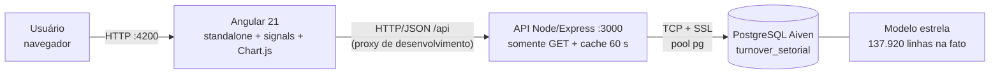
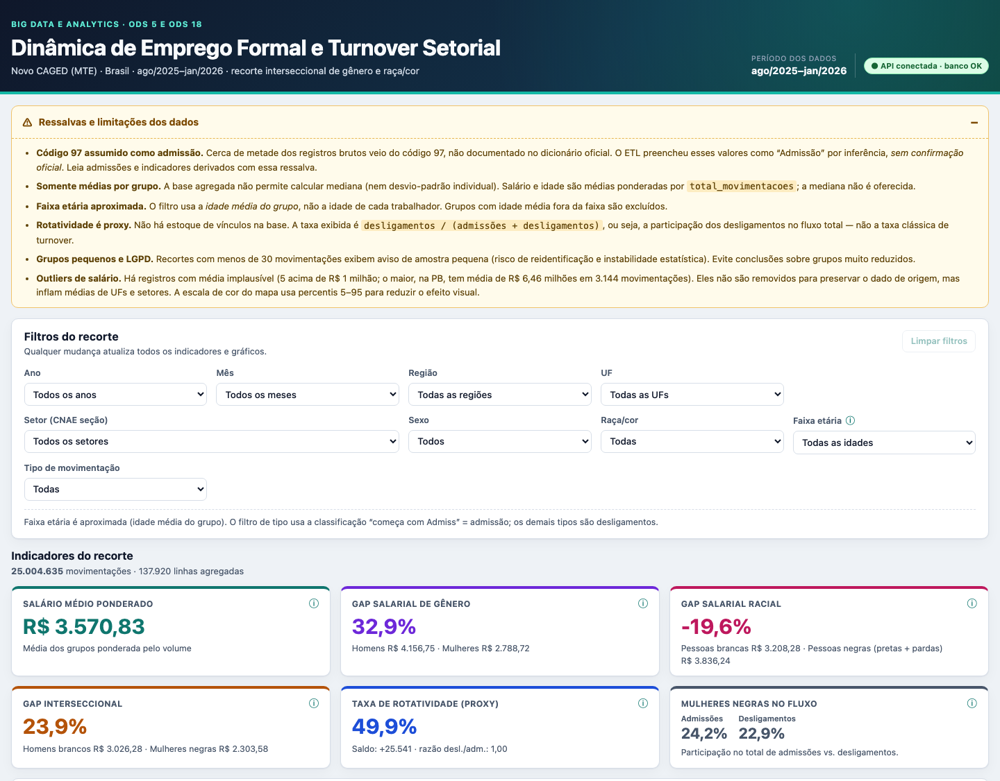
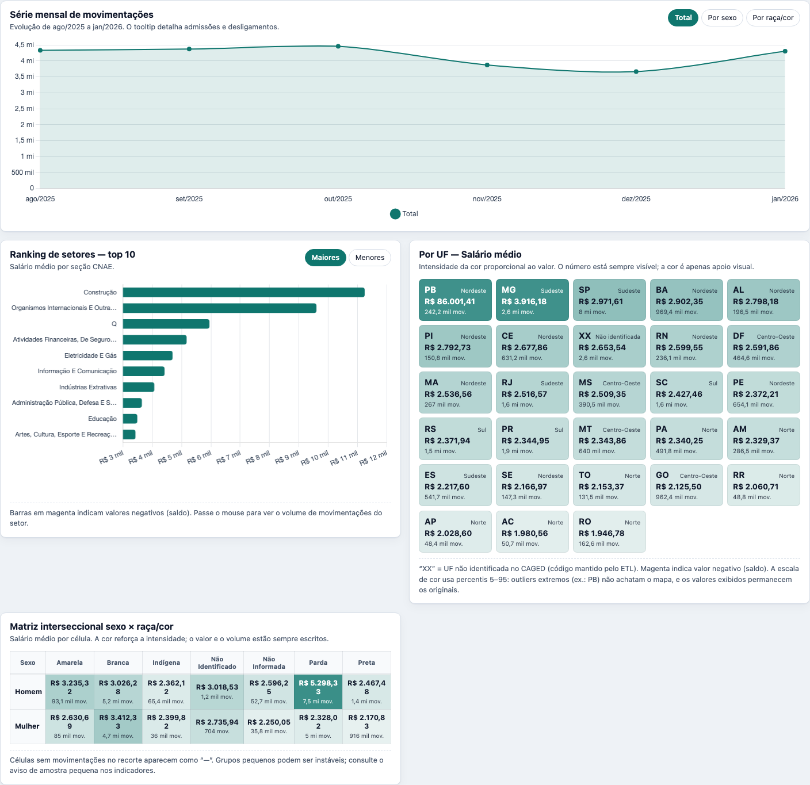
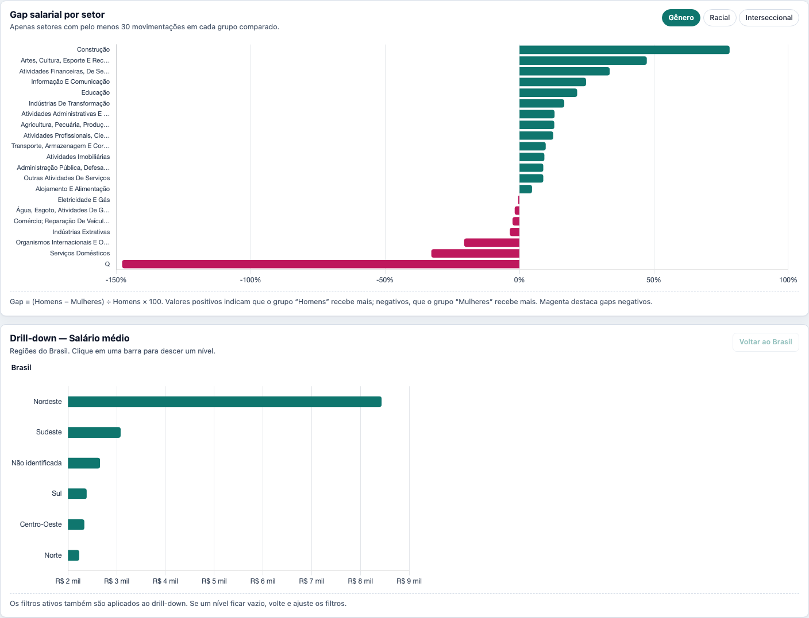
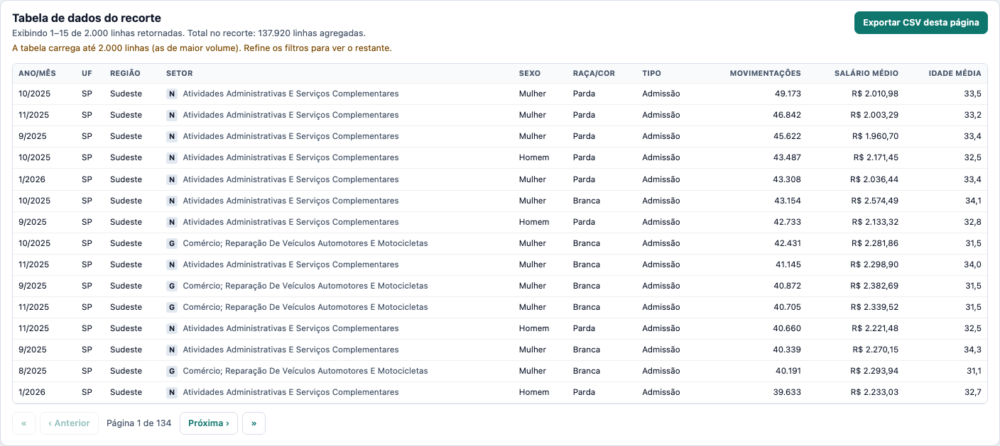

# Dashboard Analítico — Dinâmica de Emprego Formal e Turnover Setorial

Dashboard local da Fase 6 da disciplina **Big Data e Analytics**. Consome o PostgreSQL da
Aiven (schema estrela do Novo CAGED) por meio de uma **API Node/Express somente leitura** e
apresenta KPIs interseccionais de gênero e raça/cor (ODS 5 e ODS 18), filtros dinâmicos,
gráficos e drill-down.

> **Nada é publicado/deployado.** Tudo roda em `localhost` por decisão de escopo.

---

## 1. Arquitetura

O navegador não pode falar diretamente com o PostgreSQL (protocolo TCP e risco de expor
credenciais). A API é a única camada que conhece as credenciais.



Fluxo de uma requisição:

1. O Angular monta a query string a partir dos filtros (signals).
2. O proxy do `ng serve` encaminha `/api/*` para `http://localhost:3000`.
3. A API valida cada parâmetro contra `/api/meta/filters`, monta SQL **parametrizado** e consulta
   o pool do `pg`.
4. A resposta JSON (números convertidos de `NUMERIC`/`BIGINT` para `number`) é cacheada por 60 s
   em memória.

---

## 2. Execução local em um comando

Pré-requisitos: **Node.js 20+** (testado com Node 24), npm e credenciais do PostgreSQL da Aiven.

```bash
cd dashboard
cp api/.env.example api/.env     # preencha PGHOST, PGPORT, PGUSER, PGPASSWORD
npm install && npm run setup
npm run dev                       # API :3000 + Angular :4200
```

Abra **http://localhost:4200**. O `npm run dev` usa `concurrently` e encerra os dois processos
juntos (`-k`).

### Variáveis de ambiente (`dashboard/api/.env`)

| Variável | Obrigatória | Descrição |
|---|---|---|
| `PGHOST` | sim | Host do PostgreSQL na Aiven |
| `PGPORT` | sim | Porta (a Aiven usa portas altas, ex. 21914) |
| `PGUSER` | sim | Usuário. Ideal: `dashboard_ro` (somente leitura) |
| `PGPASSWORD` | sim | Senha do usuário |
| `PGDATABASE` | sim | `turnover_setorial` |
| `PORT` | não | Porta da API (padrão `3000`) |
| `CORS_ORIGIN` | não | Origem permitida (padrão `http://localhost:4200`; aceita lista separada por vírgula) |
| `PGSSLMODE` | não | `require` (padrão, Aiven) ou `disable` (PostgreSQL local) |
| `PGSSLROOTCERT` | não | Caminho do certificado CA (PEM). Se informado, valida o certificado de verdade |

O arquivo `.env` é ignorado pelo Git. A API encerra na inicialização listando as variáveis
ausentes, sem imprimir valores.

### Desenvolvimento sem Aiven (opcional)

É possível apontar para um PostgreSQL local:

```env
PGHOST=localhost
PGPORT=5432
PGUSER=postgres
PGPASSWORD=postgres
PGDATABASE=turnover_setorial
PGSSLMODE=disable
```

Carregue `../../etl/schema.sql` e o CSV agregado. O apêndice A traz um roteiro de carga local.

---

## 3. Estrutura de pastas

```text
dashboard/
├── package.json              # scripts raiz (setup, dev, test:api, verify:data)
├── .gitignore
├── README.md
├── api/
│   ├── package.json
│   ├── .env.example          # modelo sem valores reais
│   ├── scripts/verify-data.js
│   ├── test/businessRules.test.js
│   └── src/
│       ├── server.js         # Express, CORS, cache, erros, shutdown
│       ├── db.js             # Pool pg + SSL + conversão numérica
│       ├── filters.js        # validação + WHERE parametrizado
│       ├── regions.js        # UF → região (mapa fixo)
│       ├── businessRules.js  # mapeamentos, métricas, gaps, faixas
│       ├── meta.js           # SELECT DISTINCT das dimensões
│       ├── cache.js
│       └── routes/           # meta, kpis, charts, drilldown, table
└── web/
    ├── proxy.conf.json       # /api → localhost:3000
    └── src/app/
        ├── core/             # ApiService, FiltersStore, MetricStore, tipos, formatação
        └── components/       # filters-panel, kpi-cards, gráficos, tabela, ressalvas
```

---

## 4. Indicadores (regras de negócio e fórmulas)

### 4.1 Classificação das movimentações

| Classe | Regra |
|---|---|
| **Admissão** | `tipo_movimentacao` começa com “Admiss” (inclui “Admissão Por Reintegração”) |
| **Desligamento** | qualquer outro valor (demissão, a pedido, término de contrato, aposentadoria, morte, acordo, ignorado, culpa recíproca) |

Predicado SQL fixo: `tm.tipo_movimentacao ILIKE 'admiss%'`.

> **Ressalva do código 97:** as linhas cujo tipo veio do código 97 (~50% dos registros brutos)
> foram **assumidas como admissão** no ETL, por inferência, sem confirmação oficial. Admissões,
> saldo e todos os indicadores derivados devem ser lidos com essa ressalva.

### 4.2 Proxies de rotatividade

A base **não possui estoque de vínculos** (não há quantos trabalhadores estavam empregados em
cada mês). Portanto não é possível calcular a taxa clássica `movimentações ÷ estoque`.

| Indicador | Fórmula |
|---|---|
| `admissoes` | Σ `total_movimentacoes` da classe Admissão |
| `desligamentos` | Σ `total_movimentacoes` da classe Desligamento |
| `saldo` | `admissoes − desligamentos` |
| **Taxa de rotatividade (proxy)** | `desligamentos ÷ (admissoes + desligamentos) × 100` |
| **Razão desligamento/admissão** | `desligamentos ÷ admissoes` |

### 4.3 Médias ponderadas (obrigatório)

Nunca usar `AVG(salario_medio)` ou `AVG(idade_media)` simples: cada linha já é uma média de
grupo. A média agregada correta é ponderada pelo volume do grupo.

```sql
SUM(f.salario_medio * f.total_movimentacoes) FILTER (WHERE f.salario_medio IS NOT NULL)
/ NULLIF(SUM(f.total_movimentacoes) FILTER (WHERE f.salario_medio IS NOT NULL), 0)
```

O mesmo vale para `idade_media`. Linhas com `NULL` são ignoradas na ponderação.

Conferência local (recorte completo):

| Método | Salário | Idade |
|---|---|---|
| **Ponderado (correto)** | R$ 3.570,83 | 32,9 anos |
| `AVG` simples (incorreto) | R$ 2.902,48 | 33,9 anos |

Execute `npm run verify:data` a partir de `dashboard/` (ou `npm run verify:data` em `api/`) para
repetir a conferência e validar os totais de aceite.

### 4.4 Gaps salariais

| Gap | Fórmula | Filtros ignorados no cálculo |
|---|---|---|
| Gênero | `(salário homens − salário mulheres) ÷ salário homens × 100` | filtro de sexo |
| Racial | `(salário brancas − salário negras) ÷ salário brancas × 100` | filtro de raça/cor |
| Interseccional | `(salário homens brancos − salário mulheres negras) ÷ salário homens brancos × 100` | filtros de sexo e raça/cor |

- **Negra** = raça/cor `Preta` + `Parda` (ODS 18), conforme `PERFIL_RULES` em
  `businessRules.js`.
- Os demais filtros ativos (ano, mês, região, UF, setor, faixa etária, tipo) são respeitados.
- Quando o usuário filtra a dimensão do próprio gap, a UI exibe **“n/d”** com tooltip
  explicando, pois o gap só faz sentido comparando grupos. Para o gap interseccional, qualquer
  filtro de sexo ou raça/cor o torna “n/d”.
- Os grupos são resolvidos por correspondência **case-insensitive e sem acentos**
  (`mulher|feminin`, `homem|mascul`, `preta|parda`, `branca`). Se o dicionário do CAGED mudar e
  algum mapeamento não casar, a API **falha na inicialização** listando os valores encontrados.

### 4.5 Participação de mulheres negras no fluxo

Para admissões e para desligamentos, separadamente:

```
movimentações de mulheres negras na classe
÷ total de movimentações da classe
× 100
```

Se a participação nos desligamentos for maior que nas admissões, o grupo sai proporcionalmente
mais do que entra.

### 4.6 Cobertura e LGPD

- O total de movimentações do recorte aparece sempre no topo dos KPIs.
- Se o total for **< 30**, a UI mostra “Amostra pequena (< 30)”, conforme a preocupação de
  reidentificação/instabilidade registrada na Fase 2 (LGPD).
- O endpoint de gaps por setor aplica a mesma amostra mínima de 30 **em cada grupo comparado**.

### 4.7 Os seis cards exibidos

1. Salário médio ponderado do recorte.
2. Gap salarial de gênero (%).
3. Gap salarial racial (%).
4. Gap interseccional (%).
5. Taxa de rotatividade proxy (%), com saldo líquido e razão desl./adm. em subtexto.
6. Participação de mulheres negras nas admissões vs. nos desligamentos.

Cada card possui ícone ⓘ com a fórmula e o critério de “n/d”.

---

## 5. Filtros e visualizações

### 5.1 Filtros

Ano, mês, região, UF (dependente da região), setor (CNAE seção), sexo, raça/cor, faixa etária e
tipo de movimentação. Qualquer mudança refaz as chamadas com debounce de ~250 ms e
`switchMap` (cancela a requisição anterior). “Limpar filtros” restaura o Brasil inteiro.

Estado em **signals**; nada de `localStorage` para dados.

**Faixa etária aproximada:** a base só tem `idade_media` por grupo. As faixas (até 24, 25–39,
40–54, 55+) filtram a média do grupo (`idade_min`/`idade_max`), não a idade individual. A UI
rotula “(média do grupo)” e explica no tooltip.

### 5.2 Visualizações

1. **Série mensal** (linha): total, por sexo ou por raça/cor. O tooltip traz admissões,
   desligamentos e saldo do ponto.
2. **Ranking de setores** (top 10, barras horizontais; maiores/menores).
3. **Por UF**: grade de cards com intensidade de cor + valor escrito (não depende só de cor).
4. **Matriz interseccional** sexo × raça/cor, heatmap em tabela com escala de cor.
5. **Gap por setor** com seletor gênero/racial/interseccional e amostra mínima.
6. **Drill-down** Região → UF → Setor, com breadcrumb “Brasil › Nordeste › BA”.
7. **Tabela** paginada no cliente, com export CSV da página visível.

O seletor de métrica controla ranking, UF, matriz e drill-down. Métricas disponíveis:
`salario_medio`, `rotatividade`, `saldo`, `admissoes`, `desligamentos`,
`total_movimentacoes`, `idade_media`. **Mediana não existe** na base e não é oferecida.

---

## 6. Dicionário da API

Base: `http://localhost:3000/api`. Todos os endpoints são **GET**. Filtros comuns:
`ano`, `mes`, `regiao`, `uf`, `setor`, `sexo`, `raca_cor`, `tipo` (`admissao|desligamento`),
`idade_min`, `idade_max` — aceitam múltiplos valores separados por vírgula.
Valores inválidos → **400**. Erros internos → **500** genérico. Cache de 60 s por rota + query
(cabeçalho `X-Cache: HIT|MISS`).

| Endpoint | Parâmetros | Retorno |
|---|---|---|
| `GET /health` | — | `{status:"ok", db:true}` (faz `SELECT 1`; 503 se o banco cair) |
| `GET /meta/filters` | — | anos, meses, UFs + região, setores, sexos, raças, tipos, faixas, totais e período |
| `GET /kpis` | filtros comuns | KPIs da seção 4.7 + cobertura |
| `GET /series/mensal` | filtros + `grupo=total\|sexo\|raca_cor` | `{grupo, series:[{grupo, rotulo, pontos:[{ano, mes, admissoes, ...}]}]}` |
| `GET /ranking/setores` | filtros + `metrica`, `limit` (1–50), `order=asc\|desc` | itens com `chave`, `rotulo`, `valor`, `total_movimentacoes` |
| `GET /mapa/uf` | filtros + `metrica` | itens com `uf`, `regiao`, `valor`, `total_movimentacoes` |
| `GET /interseccao` | filtros + `metrica` | `sexos`, `racas`, `celulas:[{sexo,raca_cor,valor,total_movimentacoes}]` |
| `GET /gaps/setores` | filtros + `tipo_gap=genero\|racial\|interseccional` | setores com amostra ≥ 30 em cada grupo, salários e gap |
| `GET /drilldown` | filtros + `nivel=regiao\|uf\|setor`, `pai`, `metrica` | itens do nível (`pai` = região ou UF) |
| `GET /tabela` | filtros + `limit` (1–5000, padrão 2000) | recorte no grão da fato (extensão documentada) |

Exemplos:

```bash
curl "http://localhost:3000/api/health"
curl "http://localhost:3000/api/kpis?ano=2025&mes=12&regiao=Nordeste&sexo=Mulher"
curl "http://localhost:3000/api/ranking/setores?metrica=rotatividade&limit=10"
curl "http://localhost:3000/api/drilldown?nivel=uf&pai=Nordeste&metrica=admissoes"
curl "http://localhost:3000/api/gaps/setores?tipo_gap=interseccional"
```

`metrica` é validado contra whitelist e mapeado para uma **expressão SQL fixa** no servidor.
Nunca há interpolação de nome de coluna, direção de ordenação ou valor de filtro em SQL.

---

## 7. Segurança

- Credenciais **somente** em `dashboard/api/.env` (ignorado pelo Git); versiona-se apenas
  `.env.example`.
- Todas as queries usam `$1, $2...`; os filtros são validados contra os valores reais das
  dimensões antes de virarem parâmetros.
- A API é somente leitura: nenhum endpoint de escrita, nenhum `INSERT/UPDATE/DELETE`.
- `ssl: { rejectUnauthorized: false }` por padrão (equivalente a `sslmode=require`); se
  `PGSSLROOTCERT` for informado, a validação do certificado é ativada.
- CORS restrito a `CORS_ORIGIN`; o Angular só conhece `/api` via proxy.
- Senha e string de conexão nunca são logadas.
- Cache em memória de 60 s reduz consultas repetidas ao free tier.

### Usuário somente leitura (Terraform — opcional)

`terraform/main.tf` cria `aiven_pg_user.dashboard_ro`, e `outputs.tf` expõe a senha com
`sensitive = true`. O provider **não gerencia GRANTs de tabela**; execute uma vez, com o usuário
administrador:

```bash
cd terraform
terraform apply
export PGURL="$(terraform output -raw postgresql_service_uri)"
export RO_PASS="$(terraform output -raw dashboard_ro_password)"

psql "$PGURL" -c "GRANT CONNECT ON DATABASE turnover_setorial TO dashboard_ro;"
psql "$PGURL" -c "GRANT USAGE ON SCHEMA public TO dashboard_ro;"
psql "$PGURL" -c "GRANT SELECT ON ALL TABLES IN SCHEMA public TO dashboard_ro;"
psql "$PGURL" -c "ALTER DEFAULT PRIVILEGES IN SCHEMA public GRANT SELECT ON TABLES TO dashboard_ro;"
```

Depois use `PGUSER=dashboard_ro` e `PGPASSWORD=$RO_PASS` em `api/.env`. Não conceda
`INSERT/UPDATE/DELETE`. Se o `apply` não puder ser validado no ambiente do avaliador, o código e
o passo a passo acima ficam como entrega; nada do que já funciona é alterado.

---

## 8. Verificação e testes

```bash
# a partir de dashboard/
npm run test:api       # testes de regras de negócio (node:test)
npm run verify:data    # confere linhas, movimentações e ponderação no banco
```

Resultado esperado da conferência:

- **137.920** linhas na fato;
- **25.004.635** movimentações;
- salário ponderado **R$ 3.570,83** (o `AVG` simples daria R$ 2.902,48);
- idade ponderada **32,9** (a média simples daria 33,9).

Teste manual rápido de validação e cache:

```bash
curl -i "http://localhost:3000/api/kpis?ano=1999"     # 400
curl -i "http://localhost:3000/api/health"            # 200, db:true
curl -i "http://localhost:3000/api/kpis" | grep X-Cache
```

---

## 9. Limitações (fixas)

1. **Código 97:** ~50% dos registros brutos tiveram o tipo assumido como “Admissão” por
   inferência do ETL, sem confirmação oficial.
2. **Médias agregadas:** a base só tem médias por grupo; **mediana** e desvio-padrão individual
   não são calculáveis. Toda média exibida é ponderada por `total_movimentacoes`.
3. **Sem estoque de vínculos:** a rotatividade é um **proxy** (`desligamentos ÷ fluxo total`),
   não a taxa clássica (`movimentações ÷ estoque`).
4. **Faixa etária aproximada:** filtra a idade **média do grupo**, não a idade individual.
5. **Grupos pequenos/LGPD:** recortes < 30 movimentações geram aviso; gaps por setor exigem 30
   em cada grupo.
6. **Composição:** gaps não são ajustados por setor, ocupação, jornada ou escolaridade. Um gap
   agregado pode refletir composição setorial e outliers de salário médio, não discriminação
   pura.
7. **Outliers de salário:** há **5 registros com média acima de R$ 1 milhão** e 220 acima de
   R$ 50 mil. O maior é um grupo da PB (Construção, ago/2025, 3.144 movimentações) com média de
   **R$ 6.458.833,02**. O dashboard **não remove outliers** para preservar o dado de origem; por
   isso a média ponderada geral (R$ 3.570,83) e o mapa por UF são sensíveis a esses registros.
   Excluindo apenas os 5 acima de R$ 1 milhão, o salário ponderado cairia para R$ 2.600,53. A
   escala de cor do mapa usa percentis 5–95 para não achatar a visualização.
8. **Qualidade de dimensões:** as seções CNAE `Q` e `Z` vêm sem descrição no CSV; o dashboard
   exibe o código. `XX` é UF não identificada no CAGED.

---

## 10. Análise crítica dos resultados (ODS 5 e ODS 18)

> Os valores abaixo foram observados no recorte completo (ago/2025–jan/2026) e servem de ponto
> de partida. **Revalide com a sua instância da Aiven** e substitua os trechos entre colchetes
> pela interpretação da sua análise.

### 10.1 Panorama

| Indicador | Valor observado |
|---|---|
| Linhas na fato | 137.920 |
| Movimentações | 25.004.635 |
| Salário médio ponderado | R$ 3.570,83 |
| Rotatividade proxy | 49,9% |
| Saldo | +25.541 |
| Mulheres negras — admissões | 24,2% |
| Mulheres negras — desligamentos | 22,9% |

> **Leitura obrigatória dos outliers:** o valor de PB (R$ 86.001,41) e o salário da Construção
> (R$ 11.242,65) são inflados por poucos registros com médias implausíveis — o maior deles tem
> 3.144 movimentações e média de R$ 6.458.833,02. Sem os 5 registros acima de R$ 1 milhão, o
> salário ponderado geral seria R$ 2.600,53. Os dados não foram limpos para manter a
> rastreabilidade; interprete rankings e médias por UF/setor com essa ressalva.

### 10.2 Gap de gênero (ODS 5)

- Gap agregado: **32,9%** (homens R$ 4.156,75; mulheres R$ 2.788,72).
- Maiores gaps por setor: **Construção (78,1%)**, Artes/Cultura/Esporte (47,3%),
  Financeiras/Seguros (33,5%).
- Interpretação: [explicar se o padrão se mantém dentro de um mesmo setor, se há segregação
  ocupacional e como o código 97 pode afetar o salário médio].
- Rotatividade por sexo: homens **50,2%**, mulheres **49,6%** — diferença pequena no agregado,
  mas [verificar se muda em setores específicos e para mulheres negras].

### 10.3 Gap racial (ODS 18)

- Gap agregado: **−19,6%** (brancas R$ 3.208,28; negras R$ 3.836,24). O sinal negativo indica
  que, **nesta métrica ponderada e sem controle de composição**, o grupo negro aparece com média
  maior.
- Isso **não** deve ser lido como ausência de desigualdade racial. A média simples por raça dá
  outro sinal (Parda R$ 2.851,18 vs. Branca R$ 3.367,12), e o resultado ponderado é puxado por
  grupos de altíssimo volume e salário médio elevado (ex.: homens pardos, R$ 5.298,33).
- Maiores gaps por setor: seção **Q (76,9%)**, Organismos Internacionais (43,7%),
  Eletricidade/Gás (40,0%), Financeiras (34,0%). A seção Q está sem descrição no CSV e tem
  salário médio atípico — [investigar antes de usar como conclusão].
- Interpretação: [discutir composição setorial, outliers, qualidade do salário médio e por que a
  ponderação muda o sinal; evitar afirmação de “vantagem racial” sem controle].

### 10.4 Gap interseccional (mulher negra vs. homem branco)

- Gap agregado: **23,9%** (homens brancos R$ 3.026,28; mulheres negras R$ 2.303,58).
- Maiores gaps por setor: Financeiras (55,6%), Informação/Comunicação (49,1%),
  Artes/Cultura (48,1%), Eletricidade/Gás (42,3%).
- Interpretação: [comparar com o gap de gênero e o racial; mostrar que a desvantagem da mulher
  negra não é a soma mecânica dos dois gaps; comentar setores de maior e menor gap].

### 10.5 Rotatividade por perfil e setor

- Maiores taxas proxy: Administração Pública (59,8%), Educação (54,2%), Organismos
  Internacionais (53,7%), Agricultura (52,1%).
- Menores: Eletricidade/Gás (40,9%), Artes/Cultura (46,8%), Profissionais/Científicas (48,4%).
- Mulheres negras: rotatividade **48,4%**, abaixo da média nacional (49,9%), apesar do salário
  médio menor (R$ 2.170,83 para mulheres pretas). [Interpretar: menor rotatividade pode indicar
  estabilidade ou dificuldade de mobilidade; verificar por setor e por tipo de desligamento.]
- Interpretação: [relacionar rotatividade com salário, setor e perfil; lembrar que o proxy não
  usa estoque e que admissões incluem o código 97].

### 10.6 Síntese para os ODS

- **ODS 5:** [síntese sobre gap de gênero, setores críticos e rotatividade].
- **ODS 18:** [síntese sobre gap racial, limites da medida e setores críticos].
- **Interseccionalidade:** [síntese sobre mulher negra, dupla desvantagem salarial e o que os
  dados permitem/não permitem afirmar].
- **Recomendações:** [ex.: transparência salarial por setor, metas, análise com estoque de
  vínculos e dados individuais para mediana].

---

## 11. Screenshots

Prints gerados a partir da execução local (1440 px, filtros limpos):


*Figura 1 — Cabeçalho, ressalvas, filtros e os seis KPIs.*


*Figura 2 — Série mensal, ranking de setores, mapa por UF e matriz interseccional.*


*Figura 3 — Gap por setor e drill-down Região → UF → Setor com breadcrumb.*


*Figura 4 — Tabela paginada e exportação CSV.*

---

## 12. Decisões técnicas e aprendizados

| Decisão | Por quê |
|---|---|
| **API intermediária** | O navegador não fala PostgreSQL; a API esconde credenciais, valida entrada e limita o que o front pode consultar (somente GET). |
| **Médias ponderadas** | Cada linha da fato é um grupo; `AVG` simples trata grupos de 1 e de 50.000 movimentações como iguais. A ponderação por `total_movimentacoes` recupera a média do recorte. |
| **Whitelist de métricas** | O nome da métrica vem da URL; mapear para uma expressão fixa evita SQL injection e garante que “mediana” (impossível) não seja oferecida. |
| **Validação contra `/meta/filters`** | Os rótulos de sexo/raça/cor são dados, não constantes: validar contra o banco evita 400 silencioso e permite detectar mudanças no dicionário do CAGED. |
| **Cache de 60 s** | O free tier da Aiven é limitado; filtros mudam com frequência, mas consultas repetidas (voltar um filtro, recarregar) se beneficiam do cache. |
| **Pool de conexões** | Evita abrir conexão SSL a cada requisição; `max: 5` é suficiente para uso local e respeita o free tier. |
| **SQL parametrizado** | Filtros, limites e listas de UFs/raças vão como `$n`; regiões e métricas usam expressões fixas. |
| **Signals + `switchMap`** | Estado de filtros reativo e cancelamento de requisições antigas evitam respostas fora de ordem ao digitar/trocar filtros. |
| **Chart.js + CSS próprio** | Menos dependências que Angular Material; grid/flex resolvem o layout responsivo. |
| **Tabela limitada a 2.000 linhas** | 137.920 linhas em JSON seriam pesadas para o navegador; a UI avisa e permite refinar filtros. A exportação cobre a página visível. |

Aprendizados: [descreva o que o grupo aprendeu sobre agregação, ponderação, qualidade de
dados do CAGED, interseccionalidade e comunicação de incerteza].

---

## 13. Solução de problemas

| Sintoma | Causa provável | Ação |
|---|---|---|
| API encerra listando variáveis | `.env` ausente/incompleto | `cp api/.env.example api/.env` e preencha |
| `/api/health` retorna `db:false` | credenciais/rede/SSL | confira host/porta/usuário; teste `psql`; Aiven pode estar pausada |
| Erro de certificado | `PGSSLROOTCERT` inválido | remova a variável ou aponte para o CA correto |
| Página abre sem dados | API não subiu | veja o terminal do `npm run dev`; confirme `:3000` |
| `EADDRINUSE` | porta 3000/4200 ocupada | encerre o processo anterior ou ajuste `PORT` |
| Filtros retornam vazio | combinação sem dados (ex.: UF de outra região) | use “Limpar filtros” e combine aos poucos |
| Gap “n/d” | filtro de sexo/raça ativo | remova o filtro correspondente; tooltip explica |

---

## Apêndice A — Carga local para testes

Com um PostgreSQL local vazio:

```bash
createdb turnover_setorial
psql -d turnover_setorial -f ../etl/schema.sql

psql -d turnover_setorial <<'SQL'
CREATE TABLE stg_mov (
  ano text, mes text, sigla_uf text, cnae_2_secao text, setor_descricao text,
  sexo text, raca_cor text, tipo_movimentacao text, total_movimentacoes text,
  salario_medio text, idade_media text
);
\copy stg_mov FROM '../etl/caged.csv' WITH (FORMAT csv, HEADER true)

INSERT INTO dim_tempo (ano, mes) SELECT DISTINCT ano::smallint, mes::smallint FROM stg_mov;
INSERT INTO dim_localizacao (sigla_uf)
  SELECT DISTINCT (CASE WHEN sigla_uf = 'UF não identificada' THEN 'XX' ELSE sigla_uf END) FROM stg_mov;
INSERT INTO dim_setor (cnae_2_secao, setor_descricao)
  SELECT DISTINCT ON (cnae_2_secao) cnae_2_secao, setor_descricao FROM stg_mov
  ORDER BY cnae_2_secao, length(setor_descricao) DESC;
INSERT INTO dim_perfil (sexo, raca_cor) SELECT DISTINCT sexo, raca_cor FROM stg_mov;
INSERT INTO dim_tipo_movimentacao (tipo_movimentacao)
  SELECT DISTINCT COALESCE(NULLIF(trim(tipo_movimentacao), ''), 'Admissão') FROM stg_mov;

INSERT INTO fato_movimentacao
  (id_tempo, id_localizacao, id_setor, id_perfil, id_tipo_movimentacao,
   total_movimentacoes, salario_medio, idade_media)
SELECT t.id_tempo, l.id_localizacao, s.id_setor, p.id_perfil, tm.id_tipo_movimentacao,
       st.total_movimentacoes::int, NULLIF(st.salario_medio, '')::numeric,
       NULLIF(st.idade_media, '')::numeric
  FROM stg_mov st
  JOIN dim_tempo t ON t.ano = st.ano::smallint AND t.mes = st.mes::smallint
  JOIN dim_localizacao l ON l.sigla_uf =
       (CASE WHEN st.sigla_uf = 'UF não identificada' THEN 'XX' ELSE st.sigla_uf END)
  JOIN dim_setor s ON s.cnae_2_secao = st.cnae_2_secao
  JOIN dim_perfil p ON p.sexo = st.sexo AND p.raca_cor = st.raca_cor
  JOIN dim_tipo_movimentacao tm ON tm.tipo_movimentacao =
       COALESCE(NULLIF(trim(st.tipo_movimentacao), ''), 'Admissão');

DROP TABLE stg_mov;
SQL
```

O CSV de exemplo está em `etl/caged.csv` (17 MB). O resultado deve ser 137.920 linhas e
25.004.635 movimentações.
